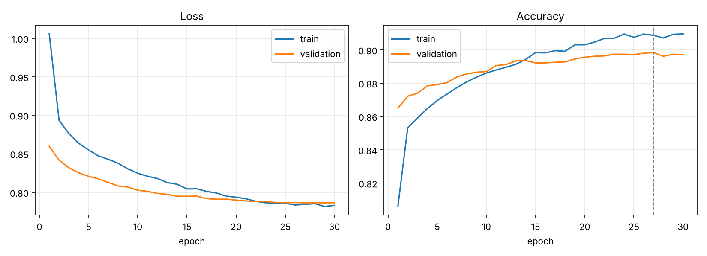
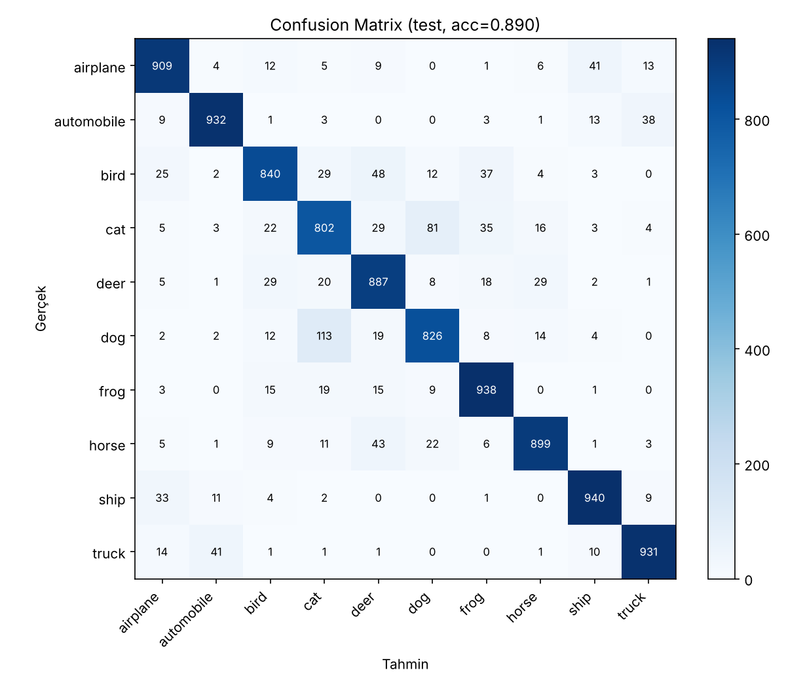
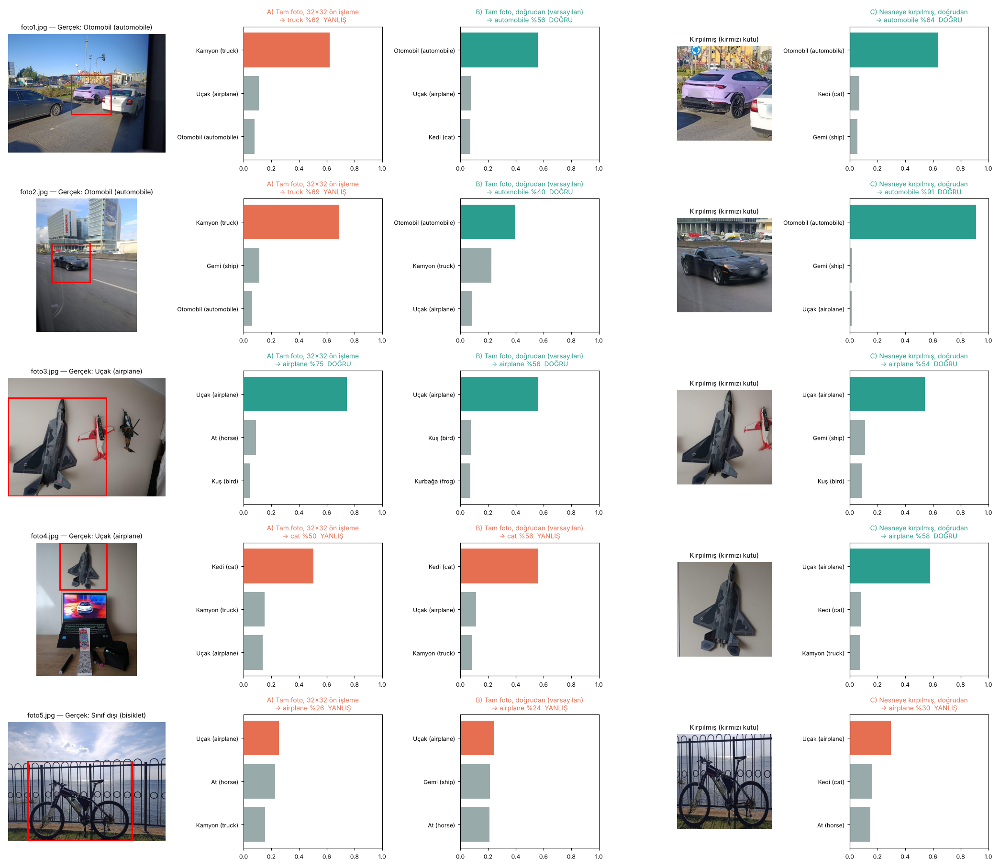
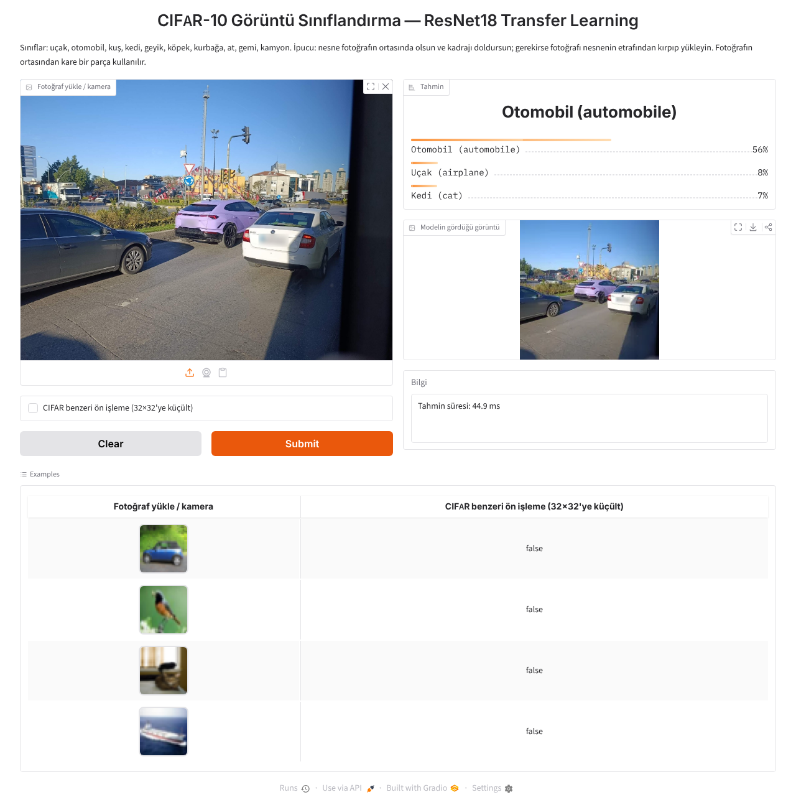

# CIFAR-10 ile Görüntü Sınıflandırma (ResNet18 + Gradio)

BIL485 Derin Öğrenme - Ödev 2: Computer Vision
Selim Şahin - 24120205068

Bu projede CIFAR-10 veri setindeki 10 sınıfı (uçak, otomobil, kuş, kedi, geyik, köpek, kurbağa, at, gemi, kamyon) tanıyan bir model eğittim. ImageNet ile önceden eğitilmiş ResNet18'i dondurup üzerine küçük bir sınıflandırıcı ekledim (transfer learning). Sonra modeli Gradio ile fotoğraf yüklenip sonucu görülebilen bir uygulamaya çevirdim.

Rapor: [rapor/Odev2_Computer_Vision_Rapor.docx](rapor/Odev2_Computer_Vision_Rapor.docx)

## Sonuçlar

Test seti (10.000 görüntü):

| Metrik | Sonuç |
|---|---|
| Accuracy | %89,04 |
| Precision (macro) | %89,06 |
| Recall (macro) | %89,04 |
| F1-score (macro) | %89,03 |

Eğitim GPU olmadan (2 çekirdekli CPU) yaklaşık 18 dakika sürdü. Bir görüntünün tahmini yaklaşık 23 ms sürüyor.




## Kendi fotoğraflarımla test

Telefonumla çektiğim 5 fotoğrafı üç şekilde denedim (D: doğru, Y: yanlış):

| Fotoğraf | Gerçek | 32x32'ye küçültüp | Doğrudan | Nesneye kırpınca |
|---|---|---|---|---|
| 1. Lamborghini Urus | Otomobil | Kamyon %62 Y | Otomobil %56 D | Otomobil %64 D |
| 2. Corvette C6 | Otomobil | Kamyon %69 Y | Otomobil %40 D | Otomobil %91 D |
| 3. Uçak maketleri | Uçak | Uçak %75 D | Uçak %56 D | Uçak %54 D |
| 4. Jet maketi + laptop | Uçak | Kedi %50 Y | Kedi %56 Y | Uçak %58 D |
| 5. Bisiklet | Sınıf dışı | Uçak %26 Y | Uçak %24 Y | Uçak %30 Y |
| **Doğru** | | **1/5** | **3/5** | **4/5** |

Nesne fotoğrafı doldurunca model iyi çalışıyor, nesne küçük kalınca ya da ortada olmayınca zorlanıyor. Bisiklet CIFAR-10'da olmadığı için model yine de bir sınıf seçiyor ama olasılığı çok düşük. Bu yüzden uygulamaya "emin değil" uyarısı ekledim. Detaylar raporun 7. bölümünde.



## Uygulamayı çalıştırma

Bilgisayarda:
```bash
pip install -r requirements.txt
python app.py
```
Sonra tarayıcıda http://127.0.0.1:7860 adresini açın.

Google Colab'da: `colab_app.ipynb` dosyasını açıp hücreleri sırayla çalıştırın. İkinci hücre bir `gradio.live` linki veriyor.



## Modeli tekrar eğitmek

```bash
python src/extract_features.py   # veriyi indirir, böler, ResNet18 ile özellikleri çıkarır
python src/train.py              # sınıflandırıcıyı eğitir, test sonuçlarını ve grafikleri kaydeder
python src/predict_photos.py     # my_photos klasöründeki fotoğrafları test eder
```

## Dosyalar

- `app.py`: Gradio uygulaması
- `colab_app.ipynb`: uygulamayı Colab'da çalıştırmak için
- `src/common.py`: sınıflar, ön işleme, model
- `src/extract_features.py`: veri bölme ve özellik çıkarma
- `src/train.py`: eğitim ve değerlendirme
- `src/predict_photos.py`: kendi fotoğraflarımla test
- `model/head.pt`: eğitilmiş sınıflandırıcı ağırlıkları
- `results/`: metrikler, grafikler, ekran görüntüsü
- `my_photos/`: test için çektiğim fotoğraflar
- `rapor/`: ödev raporu
